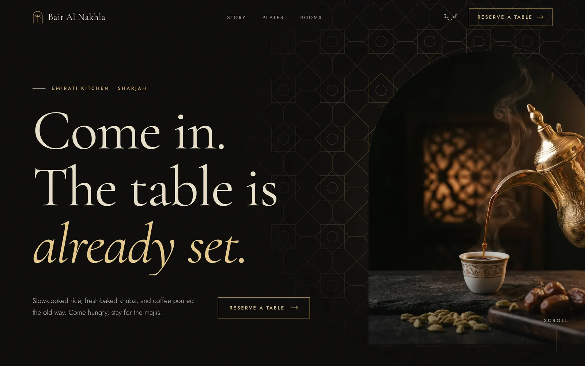
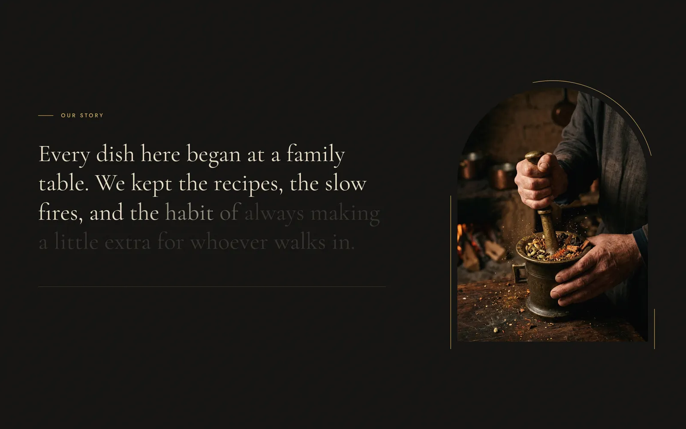
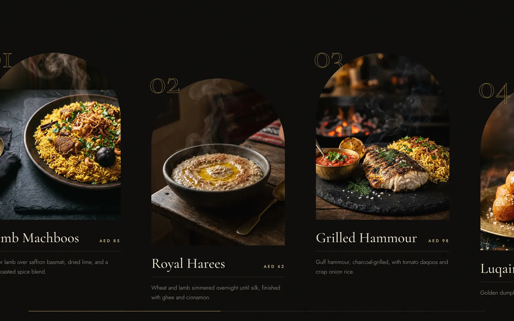
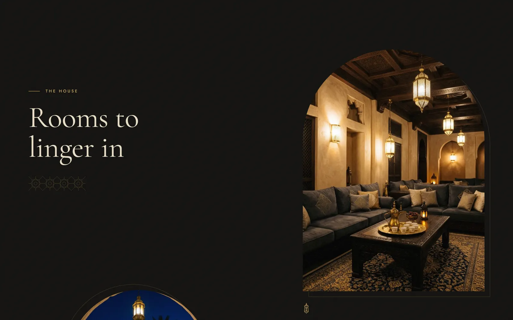
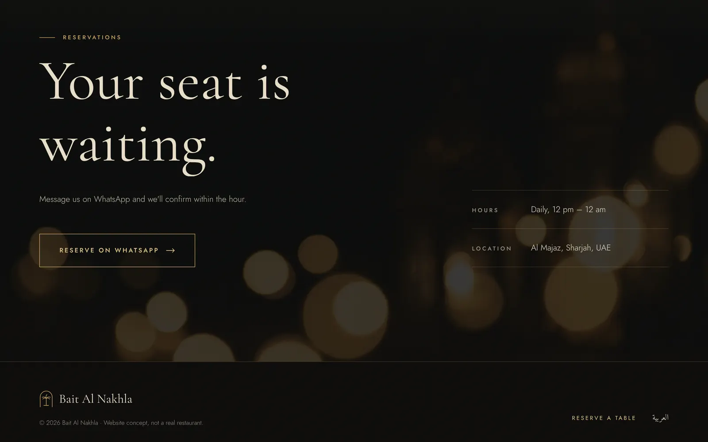
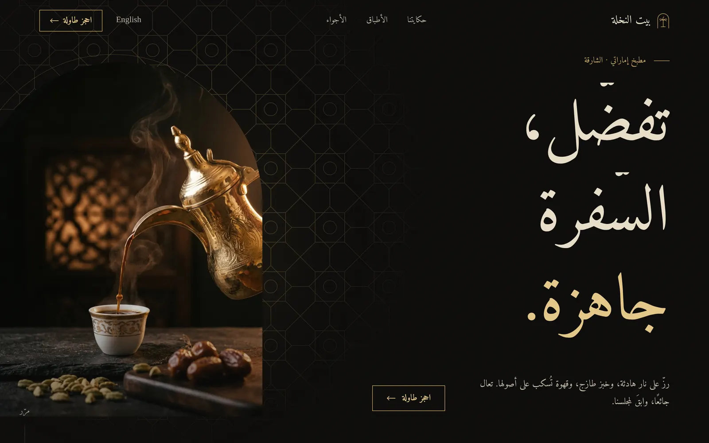
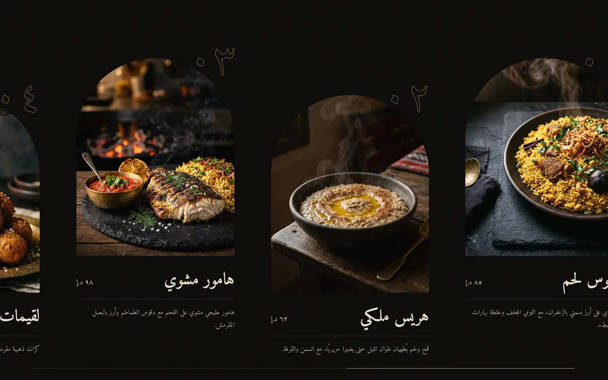
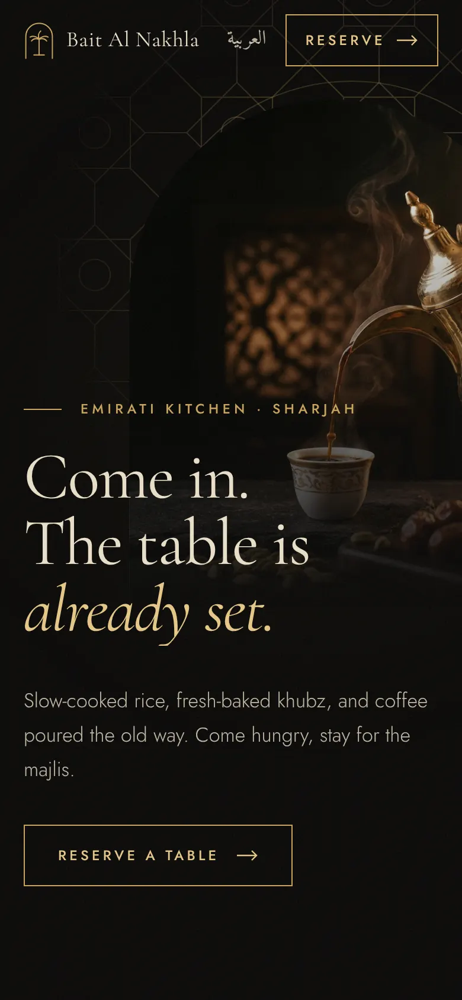
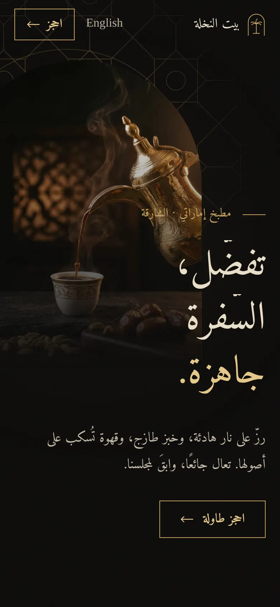

<div align="center">

# Bait Al Nakhla · بيت النخلة

**A bilingual, dark‑luxury restaurant website concept, built in Astro with cinematic scroll motion.**

English + Arabic (RTL) · Astro · Tailwind CSS v4 · GSAP ScrollTrigger · Lenis



</div>

> **Concept project.** Bait Al Nakhla ("House of the Palm") is a fictional Emirati restaurant in Al Majaz, Sharjah.
> It is not a real business, and the WhatsApp number in the code is a placeholder. The site was designed and built as a
> portfolio piece showing what a premium restaurant website can feel like.

---

## Contents

- [Preview](#preview)
- [Features](#features)
- [Tech stack](#tech-stack)
- [Getting started](#getting-started)
- [Project structure](#project-structure)
- [Design system](#design-system)
- [Motion](#motion)
- [Bilingual and RTL](#bilingual-and-rtl)
- [Accessibility and performance](#accessibility-and-performance)
- [Images](#images)
- [License](#license)

---

## Preview

| Story (pinned word reveal) | Signature plates (horizontal reel) |
|---|---|
|  |  |

| Rooms (offset parallax) | Reservations |
|---|---|
|  |  |

| Arabic hero (RTL) | Arabic plates, reel runs right to left |
|---|---|
|  |  |

<p align="center">
  
  &nbsp;&nbsp;
  
</p>

## Features

- **Two full languages:** English at `/` and Arabic at `/ar/`. The Arabic page is properly right‑to‑left, uses Arabic‑Indic numerals and has its own typography.
- **One clear goal:** every section leads to a single **Reserve a table** action, which opens WhatsApp with a prefilled message.
- **Cinematic scroll:** masked headline reveals, a pinned story where words light up as you scroll, a horizontal plates reel, offset parallax rooms and a magnetic reservation button.
- **Arch‑framed photography:** the mihrab arch is the signature shape, paired with a hand‑built SVG Khatam star pattern, a lantern icon and a palm logo mark.
- **Static and fast:** no backend, no CMS. Responsive AVIF and WebP images, self‑hosted fonts and about 51 KB of gzipped JavaScript.
- **Graceful by default:** without JavaScript or with *reduced motion* turned on, everything is visible and static. A missing photo renders an ornamental placeholder instead of breaking the build.
- **SEO ready:** canonical and `hreflang` pairs, Open Graph and Twitter tags, and `Restaurant` JSON‑LD for each language. A demo flag adds `noindex`.

## Tech stack

| Area | Choice |
|---|---|
| Framework | [Astro](https://astro.build) 7, static output |
| Styling | [Tailwind CSS](https://tailwindcss.com) v4 via `@tailwindcss/vite`, with design tokens in `@theme` |
| Motion | [GSAP](https://gsap.com) + ScrollTrigger, [Lenis](https://lenis.darkroom.engineering) smooth scroll |
| Fonts | Self‑hosted via Fontsource: Cormorant Garamond (display), Jost (UI), Amiri (Arabic) |
| Images | `astro:assets` `<Picture>` → AVIF / WebP, responsive `srcset` |
| Hosting | Any static host: Cloudflare Pages, Vercel, Netlify |

## Getting started

Requires **Node.js 22.23.4 or newer** (required by Astro 7). An `.nvmrc` is included, so `nvm use` picks the right version.

```bash
git clone https://github.com/4pfanas/bait-al-nakhla.git
cd bait-al-nakhla
npm install
npm run dev
```

Open <http://localhost:4321> for English and <http://localhost:4321/ar/> for Arabic.

| Command | What it does |
|---|---|
| `npm run dev` | Start the dev server with hot reload |
| `npm run build` | Build the production site into `dist/` |
| `npm run preview` | Serve the built `dist/` locally |

## Project structure

```text
bait-al-nakhla/
├── public/
│   ├── favicon.svg
│   └── robots.txt
├── src/
│   ├── assets/images/          # photography, looked up by filename
│   ├── components/
│   │   ├── Header.astro        # fixed header, hides on scroll down
│   │   ├── Hero.astro          # headline, arch photo, star pattern
│   │   ├── Story.astro         # pinned statement + facts
│   │   ├── Dishes.astro        # horizontal plates reel
│   │   ├── Rooms.astro         # staggered arch gallery
│   │   ├── Reserve.astro       # WhatsApp reservation section
│   │   ├── Footer.astro
│   │   ├── Home.astro          # assembles the page for a language
│   │   ├── ornament/           # Pattern, Mark (logo), Lantern (SVG)
│   │   └── ui/                 # Button, Eyebrow, SmartImage
│   ├── data/
│   │   ├── site.ts             # brand, WhatsApp, hours, demo flag
│   │   └── content.ts          # all English + Arabic copy
│   ├── layouts/Layout.astro    # <head>, SEO, JSON-LD, fonts
│   ├── lib/images.ts           # image lookup with fallback
│   ├── pages/
│   │   ├── index.astro         # English
│   │   └── ar/index.astro      # Arabic
│   ├── scripts/motion.ts       # every animation lives here
│   └── styles/global.css       # tokens, type scale, components
├── docs/screenshots/           # images used in this README
├── astro.config.mjs
└── package.json
```

## Design system

**Palette:** black and antique gold. Gold is used sparingly, for lines, numerals, labels and the call to action.

| Token | Hex | Use |
|---|---|---|
| `ink` | `#0A0908` | page background |
| `coal` | `#11100E` | alternate sections |
| `smoke` | `#1A1714` | raised surfaces, image placeholders |
| `gold` | `#C9A45C` | accents, borders, button |
| `gold-bright` | `#E6C887` | hover, highlights |
| `gold-deep` | `#8F7238` | outlined numerals, quiet ornament |
| `sand` | `#EADFC8` | main text |
| `mute` | `#9A9080` | secondary text |

**Type:** Cormorant Garamond for display, Jost for small UI text and Amiri for all Arabic. Arabic is set about 10% larger with more line height, and never letter‑spaced. The fluid type scale (`.t-hero`, `.t-h2`, `.t-h3`, `.t-statement`, `.t-body`, `.t-eyebrow`) is defined once in `global.css`, with Arabic overrides beside each style.

**Shape and texture:** arch frames (`.arch`), 1px gold hairlines, an asymmetric 12‑column layout and a very light static film grain. There are deliberately no rounded cards, drop shadows or centred‑everything layouts.

## Motion

All motion is in [`src/scripts/motion.ts`](src/scripts/motion.ts). Only `transform`, `opacity` and `clip-path` are animated.

| Section | Desktop | Phone |
|---|---|---|
| Hero | Lines rise from masks; arch reveals upward while the photo settles; the star pattern turns with scroll | Same |
| Story | Section pins, words light up one by one, gold arch outline draws itself | Word reveal without pinning |
| Plates | Section pins, row travels horizontally with a progress line; photos drift inside their arches | Cards stack and fade up |
| Rooms | Three arches move at different speeds | Captions and image zoom only |
| Reserve | Headline reveals word by word; background drifts; magnetic button with a breathing ring | Same, no magnetic effect |

`prefers-reduced-motion` turns off smooth scrolling, pinning, parallax and looping animation. Initial hidden states are applied only when a `js-motion` class is present, and a 4‑second safety timer removes it if the script never reports ready, so content can never stay hidden.

## Bilingual and RTL

- One component tree renders both languages: `Home.astro` receives `lang` and reads `content[lang]`.
- `<html lang="ar" dir="rtl">` on the Arabic page, with Tailwind logical utilities (`ms-*`, `pe-*`, `start-*`, `end-*`) throughout, so the layout mirrors without special cases.
- Direction‑aware motion: the plates reel, progress line, arrows and pattern rotation all reverse in RTL.
- Words are split on spaces only, never letters, so Arabic letters keep their joining forms during reveals.
- The language toggle links to the sibling page, remembers the choice in `localStorage` as a convenience, and never auto‑redirects.

## Accessibility and performance

- Semantic landmarks, one `h1`, a visible skip link and a clear gold focus ring on every interactive element.
- Split‑text animations keep a screen‑reader‑only copy of the full sentence.
- Touch targets are at least 44px, and body text contrast meets WCAG AA on the dark background.
- Images have explicit dimensions (no layout shift), `loading="lazy"` below the fold and a high‑priority hero image.
- Fonts are self‑hosted, split by `unicode-range` so each subset downloads only when used.

## Images

The photographs in `src/assets/images/` were **generated with AI** (Google generative AI) for this concept. They are not
photos of a real restaurant, dishes or people. The original files keep their embedded
[C2PA Content Credentials](https://c2pa.org/), which label them as AI‑generated. Replace them with real photography for any production use.

## License

© 2026 [@4pfanas](https://github.com/4pfanas). All rights reserved.

The source is published for viewing as a portfolio piece. Please ask before reusing the design, copy or images.
Third‑party libraries keep their own licences (Astro, Tailwind CSS, Lenis: MIT; GSAP: GSAP standard licence;
fonts: SIL Open Font License).
